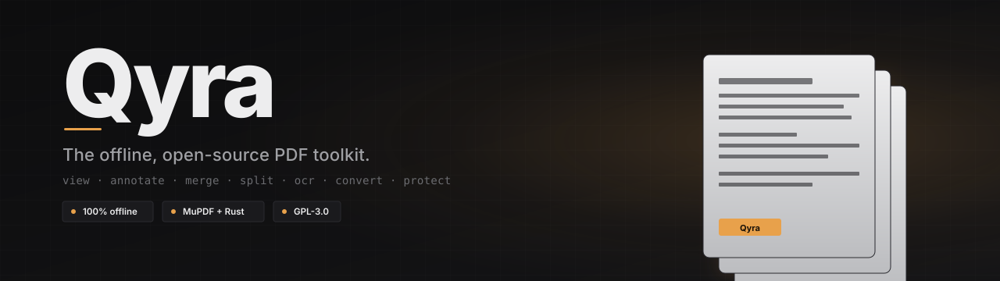

<div align="center">



<p>
  <a href="https://github.com/zParik/Qyra/releases"></a>
  <a href="LICENSE"></a>
  <a href="https://github.com/zParik/Qyra/stargazers"></a>
  <a href="https://github.com/zParik/Qyra/issues"></a>
</p>

<p>
  
  
  
  
  
  
</p>

<p>
  <a href="https://github.com/zParik/Qyra/actions/workflows/test.yml"></a>
  <a href="https://github.com/zParik/Qyra/actions/workflows/build-windows.yml"></a>
  <a href="https://github.com/zParik/Qyra/actions/workflows/build-linux.yml"></a>
</p>

<p>
  <a href="https://zparik.github.io/Qyra-page/">Website</a> ·
  <a href="#the-revamp">The revamp</a> ·
  <a href="#download">Download</a> ·
  <a href="#features">Features</a> ·
  <a href="#development">Development</a>
</p>

</div>

---

## Why Qyra?

Acrobat wants a subscription. Online PDF sites want your files. Qyra wants neither.

It's a desktop app for Linux and Windows that does the PDF work you actually do: read, mark up, sign, fill in, merge, split, compress, OCR, protect. Everything runs on your computer. The only thing it asks the internet is whether a newer version is out on GitHub. Open source under GPL-3.0.

## The revamp

v1.4.0 came out on 30 June 2026. Then uni happened xd, and the repo didn't move from early July until 11 October. When I opened it again, a few things were bad enough that patching felt pointless:

- the compressor was garbling some images, even at its lossless level;
- opening a 60 MB PDF could take 2.2 GB of RAM;
- page text looked like 144p next to Firefox's viewer;
- printing on Linux only gave you print-to-file.

So I rewrote most of it: 124 commits on the `revamp` branch, all but one of them between 11 October and 3 November. None of it is in a release yet; v1.4.0 on the Releases page is the old app.

### Sharper pages

Pages used to be rendered to JPEG, sent to the UI as base64 text and stretched to fit the window. That is where the blur came from. MuPDF now renders raw pixels in 512 px tiles, drawn 1:1 to your screen's device pixels.

### Lighter

Measured on a release build, opening the same 60 MB PDF:

| | Before | After |
|---|---|---|
| Memory (PSS) | 977 MB | about 380 MB |
| Peak RSS | 2.2 GB | 250 MB |
| CPU time to open | about 200 s | about 1 s |

The app was parsing the whole file several times on open, on 8 threads at once. It now asks MuPDF what the file contains first and skips the work it doesn't need. Scrolling also got cheaper: a scripted 8-second scroll went from 7.5 to 4.2 CPU-seconds.

### Bugs that lost work

These were the ones I'd have been embarrassed to ship to friends:

- Filled-in forms and placed signatures were never written into the file.
- Drawings were baked into the file twice when you saved twice.
- Editing a PDF with an owner password saved it unprotected.
- The compressor undid PNG predictors per byte instead of per pixel, which garbled colour images. It also wrote every object generation as 0 and could bring a deleted object back.
- Highlights, comments, drawings and signatures landed in the wrong place on rotated or cropped pages.
- Batch jobs overwrote outputs when two inputs had the same file name.

About 55 bugs in total came out of the final sweep on 3 November.

### New look

The UI was cramped (10 to 12 px text) and the viewer and tool pages looked like two different apps. The new design is white paper, an indigo tab bar and rose for anything you can click to act. One type family (Geist, bundled) and one set of tokens across the viewer, tools, settings and dialogs. The logo is now a white peacock.

### What got cut

- **macOS and Android builds.** Qyra is Linux and Windows only now. Phones will be covered by Kern, a separate app a friend of mine is building.
- **PDF to Word export.** It pulled in heavy dependencies and Qyra stays a PDF tool.
- **Tesseract.js.** OCR now uses MuPDF's built-in Tesseract, with English data bundled, so it still works offline.

### Still to do

Printing still goes through the web view. On Windows that works; on Linux you mostly get print-to-file. A native print path is next, then a release with all of the above.

## Download

Get a build from [Releases](https://github.com/zParik/Qyra/releases), or a nightly from the latest [Actions run](https://github.com/zParik/Qyra/actions). The revamp is not in a release yet.

| Platform | Formats                       |
|----------|-------------------------------|
| Windows  | `.msi`, `.exe` (NSIS)         |
| Linux    | `.AppImage`, `.deb`, `.rpm`   |

### Linux on Wayland

The AppImage ships without its own `libwayland-client.so` and uses the system one, which fixes `EGL_BAD_PARAMETER` crashes on Hyprland and other compositors. On Wayland, Qyra also sets `__NV_DISABLE_EXPLICIT_SYNC=1`, because WebKitGTK's GPU renderer dies with "Error 71 (Protocol error)" on the NVIDIA driver without it. If your machine still crashes, fall back to CPU compositing:

```bash
WEBKIT_DISABLE_DMABUF_RENDERER=1 ./Qyra.AppImage
```

## Features

### Viewer
- Tabs that survive a restart; opening a PDF while Qyra runs adds a tab to the open window
- Page strip with drag-to-reorder, find (Ctrl+F), zoom (Ctrl+wheel or pinch)
- Outline, metadata, recent-files library, command palette, light and dark theme

### Mark up
- Highlight, underline, strike out
- Freehand ink with pen pressure (`perfect-freehand`)
- Sticky notes and comments, saved as standard PDF annotations other viewers can read
- Signatures, drawn or placed, upright on any page rotation
- Fill forms (text fields, checkboxes, radio buttons), flatten them, export and import XFDF
- Redaction that removes the content underneath
- Watermarks, page numbers, Bates numbers, headers and footers

### Pages
- **Merge** PDFs into one
- **Split** by range, every page, or by bookmarks
- **Reorder**, **rotate**, **crop**, **delete** and **insert** pages
- **Batch** any of these over many files

### Convert
- PDF to images (PNG or JPEG, per page) and to plain text
- Images to PDF
- **OCR** scans into searchable PDFs, offline

### Protect and fix
- Password-protect (AES-128 or AES-256) and unlock
- Compress, with a native Rust engine
- Repair damaged files
- Strip metadata and hidden data

## Development

**Prerequisites**
- Node.js 20+
- Rust toolchain (stable)
- Tauri platform deps: https://tauri.app/start/prerequisites/
- **Windows:** run `cargo` from a *Visual Studio Developer PowerShell* so MSVC env vars are set for the native C deps (MuPDF). On Linux it builds from a normal shell.

```bash
npm install
npm run tauri dev
```

Tests and lint:
```bash
npm run test:unit   # vitest
npm run test:e2e    # Playwright, against a mocked backend
npm run test:rust   # cargo test
npm run lint
```

### Building

```bash
npm run tauri build
```

Bundles land in `src-tauri/target/release/bundle/`.

## Project layout

```
src/                React 19 + TypeScript frontend
├─ tools/           One page per standalone tool (Merge, OCR, Batch, …)
├─ viewer/          Viewer, tool sidebar, annotation and form layers
├─ render/          Tiled page rendering
├─ components/      Shared UI
├─ store/           Zustand stores
└─ hooks/           React hooks

src-tauri/
├─ src/commands/    Rust Tauri commands, one file per feature
├─ src/render/      Render worker, tile pool, thumbnail cache
├─ src/pdf/         PDF reader, writer and compressor
└─ src/utils/       Shared Rust utilities (page geometry, PDF text, saving)
```

## Tech stack

| Layer        | Choice                                                       |
|--------------|--------------------------------------------------------------|
| Shell        | [Tauri 2](https://tauri.app/)                                |
| Frontend     | React 19, TypeScript, Vite, Tailwind 4, Radix UI             |
| State        | Zustand, TanStack Query                                      |
| PDF engine   | [MuPDF](https://mupdf.com/) via `mupdf-rs`, plus `lopdf` for edits |
| OCR          | Tesseract, built into MuPDF                                  |
| Ink          | [perfect-freehand](https://github.com/steveruizok/perfect-freehand) |

## Contributing

Issues and PRs welcome. Conventions:
- One logical change per commit
- Many small commits per PR
- Merge commit only (no squash, no rebase)
- Reference an issue in the PR body when one exists

## License

[GPL-3.0](LICENSE). Use it, modify it, ship it, just keep it open.

---

<div align="center">
  <sub>Built by <a href="https://github.com/zParik">@zParik</a>. Star the repo if Qyra saves you a subscription.</sub>
</div>
